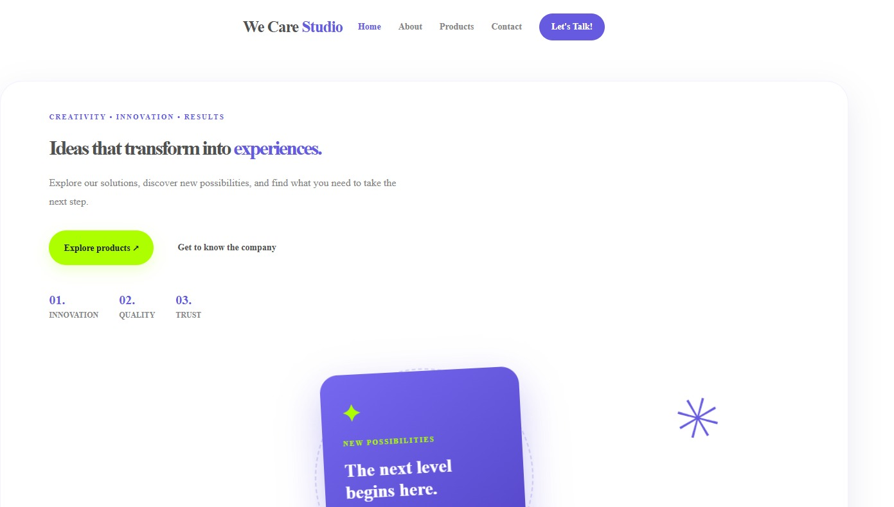

<h1>We Care Studio</h1>
 
<h2>Creativity • Innovation • Results</h2>

We Care Studio is a responsive, multi-page website developed to present a creative studio focused on innovation, design, digital solutions, and consultancy.

 

The project was developed using HTML, CSS, and JavaScript, with a modern visual identity, interactive components, and a user-friendly interface.

<b>

The main goal is to create an engaging digital experience where visitors can explore the company, discover its solutions, access account-related pages, and interact with a virtual assistant.

<b>
<h2>🌐 Live Demo</h2>
 <a href="https://[lucasgcsilva81.github.io/meu-portifolio](https://lucasgcsilva81.github.io/we-care/)/" target="_blank">Visit We Care Studio</a>
  
 <h2>✨ Features</h2>
  
  
Home Page: Modern landing page presenting the company and its identity.

  
About Page: Company presentation, vision, and values.
 
  
Products Page: Demonstration catalog with product search, category filters, and product details.

  
Contact Page: Contact form with client-side validation.

  
Login Page: User login interface.

  
 Register Page: User registration interface.

  
Dashboard Page: Personal user area interface.

  
Virtual Assistant: Interactive chatbot designed to help visitors navigate the website and find information.

  
 Responsive Design: Layout adapted to desktop, tablet, and mobile devices.

  
Interactive Navigation: Menu functionality and smooth visual transitions.

  <b>
  <h2>🛠️ Technologies Used</h2>

 HTML5 — Semantic structure and page organization.

 CSS3 — Styling, animations, responsive layouts, and visual effects.

 JavaScript — Interactive features, DOM manipulation, event handling, and chatbot functionality.

 Google Fonts — Montserrat typography.

 Git and GitHub — Version control and project hosting.

 GitHub Pages — Website deployment.

 <h2>📁 Project Structure</h2>
 
we-care/
│
├── index.html
├── about.html
├── products.html
├── contact.html
├── login.html
├── register.html
├── dashboard.html
│
├── css/
│   └── style.css
│
└── js/
    ├── script.js
    ├── auth.js
    ├── assistant.js
    ├── supabase.js

  <h2>🤖 Virtual Assistant</h2>

  
The website includes an interactive virtual assistant called We Care Assistant.

  <b>
  
Its purpose is to improve the visitor experience by providing predefined answers and navigation assistance.

  <b>
 <h3>The assistant can:</h3>

 Introduce the company.

 Provide information about products and solutions.

 Guide visitors to the account pages.

 Direct visitors to the contact page.

 Answer frequently asked questions using predefined responses.

 
The chatbot is implemented with JavaScript and uses keyword-based response handling.

 <h2>📱 Responsive Experience</h2>
  
 
The website was designed to provide a consistent browsing experience across different screen sizes, including desktops, tablets, and smartphones.

  
 <h2>🎯 Project Goals</h2>
  
 
This project was developed as part of my learning journey in web development, with the objective of improving my practical skills in:

 HTML page structure and semantic elements.

 CSS styling, positioning, animations, and responsive design.

 JavaScript logic and DOM manipulation.

 Interactive components and event listeners.

 Multi-page website organization.

 GitHub version control and deployment.

 <h2>🚀 Future Improvements</h2>

 Database integration for user information.

 Enhanced user dashboard functionality.

 AI-powered virtual assistant.

 Improved accessibility and user experience.

 Additional interactive features.

 <h2>📌 Project Status</h2>
  
 <h3>In Development</h3>
 <b>
 
We Care Studio is a demonstration project created for educational and portfolio purposes. Some features, such as account management and contact submission, may require further backend integration.

  
 <h2>👨‍💻 Developer</h2>
  
 <h3>Lucas G C Silva</h3>
  
 
Junior Web Developer | Career Transition to Programming

  
 
Currently developing practical projects using HTML, CSS, and JavaScript, focusing on continuous learning and improving my web development skills.

  
  
 &copy; We Care Studio — Ideas that inspire new possibilities.
 
  
 
    

 
 
 

 
 

 

 

